# Exhaustive Production-Grade Node.js Masterclass: From Beginner to Staff Platform Architect

[](https://github.com/manthanank/learn-nodejs/actions)
[](https://opensource.org/licenses/MIT)
[](https://nodejs.org/)
[](CONTRIBUTING.md)

Welcome to the definitive, encyclopedic masterclass on **Node.js, V8 Runtime Internals, and High-Performance Backend Engineering**. This guide is crafted for software engineers, backend architects, DevOps practitioners, and systems developers. It covers every single native module, CLI flag, V8 memory allocation mechanic, asynchronous stream pipeline, worker thread concurrency pattern, and multi-core scaling architecture—with standalone runnable code examples and line-by-line pedagogical breakdown tables for every single topic.

---

## Table of Contents
1. [Stage 1: Architecture, V8 Engine & Libuv Event Loop](#1-stage-1-architecture-v8-engine--libuv-event-loop)
   - 1.1 Node.js Runtime Architecture Overview
   - 1.2 Google V8 Engine: Ignition, TurboFan, and JIT Optimization
   - 1.3 V8 Memory Allocation: Call Stack, Heap, and Garbage Collection
   - 1.4 Hidden Classes and Inline Caching
   - 1.5 The Libuv Event Loop: The 6 Phases in Depth
   - 1.6 Microtasks vs Macrotasks: `process.nextTick()` vs `Promise`
   - 1.7 Libuv Thread Pool: `UV_THREADPOOL_SIZE` & Non-Blocking OS I/O
2. [Stage 2: Core Native Modules & Complete API Encyclopedia](#2-stage-2-core-native-modules--complete-api-encyclopedia)
   - 2.1 File System (`node:fs` & `node:fs/promises`)
   - 2.2 Path Management (`node:path`)
   - 2.3 Operating System & Hardware (`node:os`)
   - 2.4 Event-Driven Architecture (`node:events`)
   - 2.5 Binary Data & Buffers (`node:buffer`)
   - 2.6 Stream Processing & Backpressure (`node:stream`)
   - 2.7 HTTP & HTTPS Networking (`node:http`, `node:https`)
   - 2.8 HTTP/2 Multiplexing (`node:http2`)
   - 2.9 Cryptography & Security (`node:crypto`)
   - 2.10 Process Management & IPC (`node:child_process`)
   - 2.11 Multi-Threaded Parallelism (`node:worker_threads`)
   - 2.12 Multi-Process Clustering (`node:cluster`)
   - 2.13 Raw Networking: TCP & UDP (`node:net`, `node:dgram`)
   - 2.14 Data Compression (`node:zlib`)
   - 2.15 Asynchronous Execution Context (`node:async_hooks` & `AsyncLocalStorage`)
   - 2.16 Performance Hooks & Metrics (`node:perf_hooks`)
   - 2.17 Diagnostics & V8 Profiling (`node:diagnostics_channel`, `node:v8`)
   - 2.18 Native Test Runner (`node:test` & `node:assert`)
   - 2.19 Utility Functions (`node:util`)
3. [Stage 3: Module Systems, Tooling & Modern Node 22+ Features](#3-stage-3-module-systems-tooling--modern-node-22-features)
   - 3.1 CommonJS vs ES Modules: Deep Architectural Comparison
   - 3.2 The `package.json` Exports & Imports Map
   - 3.3 Native TypeScript Execution (`--experimental-strip-types`)
   - 3.4 Built-in Environment File Loading (`--env-file`)
   - 3.5 Native File Watcher (`node --watch`)
   - 3.6 Essential Node.js CLI Flags & Environment Variables
4. [Stage 4: Production Frameworks, ORMs & Data Pipelines](#4-stage-4-production-frameworks-orms--data-pipelines)
   - 4.1 Framework Benchmark: Express 5 vs Fastify vs NestJS
   - 4.2 Fastify High-Throughput Schema Validation with Ajv
   - 4.3 Database Access: Prisma vs Drizzle vs Native `pg` Pool
   - 4.4 Distributed Caching with Redis & ioredis
   - 4.5 Background Job Processing with BullMQ
5. [Stage 5: Enterprise Security, Memory Leaks & Reliability](#5-stage-5-enterprise-security-memory-leaks--reliability)
   - 5.1 Memory Leak Profiling: Chrome DevTools & Heap Snapshots
   - 5.2 Detecting and Mitigating Event Loop Lag
   - 5.3 Prototype Pollution Prevention
   - 5.4 Regular Expression Denial of Service (ReDoS) Protection
   - 5.5 Graceful Shutdown & Zero-Downtime Signal Handling
6. [Stage 6: End-to-End Enterprise Reference Implementations](#6-stage-6-end-to-end-enterprise-reference-implementations)
   - 6.1 Project 1: High-Performance Gzip Streaming File Server
   - 6.2 Project 2: Multi-Threaded Heavy Compute Worker Pool API
   - 6.3 Project 3: Distributed Microservice with AsyncLocalStorage Tracing
7. [Stage 7: Staff Node.js Architect Interview Handbook & Cheatsheet](#7-stage-7-staff-nodejs-architect-interview-handbook--cheatsheet)
   - 7.1 50 In-Depth Technical Interview Questions & Answers
   - 7.2 Native API Quick-Reference Cheatsheet
8. [Community, Contributing & Support](#8-community-contributing--support)

---

## 1. Stage 1: Architecture, V8 Engine & Libuv Event Loop

### 1.1 Node.js Runtime Architecture Overview
Node.js is not a programming language; it is an open-source, cross-platform JavaScript runtime environment built on Google's open-source V8 JavaScript engine, combined with a low-level C library called **libuv** for asynchronous I/O, c-ares for DNS resolution, llhttp for HTTP parsing, and OpenSSL for cryptographic primitives.

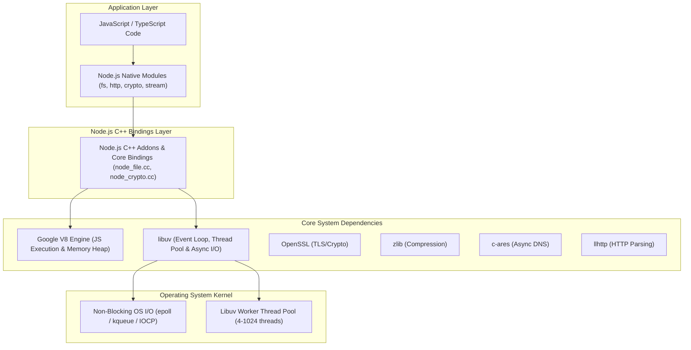

### 1.2 Google V8 Engine: Ignition, TurboFan, and JIT Optimization
V8 compiles JavaScript directly to native machine code without interpreting it beforehand. It employs a two-tier compilation pipeline:


#### Code Example: Writing V8-Friendly Monomorphic Code
```javascript
// MONOMORPHIC FUNCTION: Always called with identical object shape
function calculateTotal(order) {
  return order.price * order.quantity;
}

// Order objects share identical Hidden Class (Map)
const order1 = { price: 100, quantity: 2 };
const order2 = { price: 50, quantity: 5 };

console.log(calculateTotal(order1)); // V8 profiles { price, quantity }
console.log(calculateTotal(order2)); // TurboFan optimizes to single machine instruction!

// MEGAMORPHIC FUNCTION (Anti-pattern): Called with constantly changing shapes
const orderBad1 = { price: 100, quantity: 2 };
const orderBad2 = { quantity: 5, price: 50 }; // Different property order = Different Hidden Class!
const orderBad3 = { price: 20, count: 4 };     // Different property name!

// Forces TurboFan to deoptimize and fall back to Ignition interpreter
```

### 1.3 V8 Memory Allocation: Call Stack, Heap, and Garbage Collection
V8 divides memory into two primary zones:
1. **Call Stack**: Fixed memory allocation tracking synchronous execution contexts and primitive values.
2. **Memory Heap**: Dynamic memory allocation storing complex objects, closures, strings, and buffers.

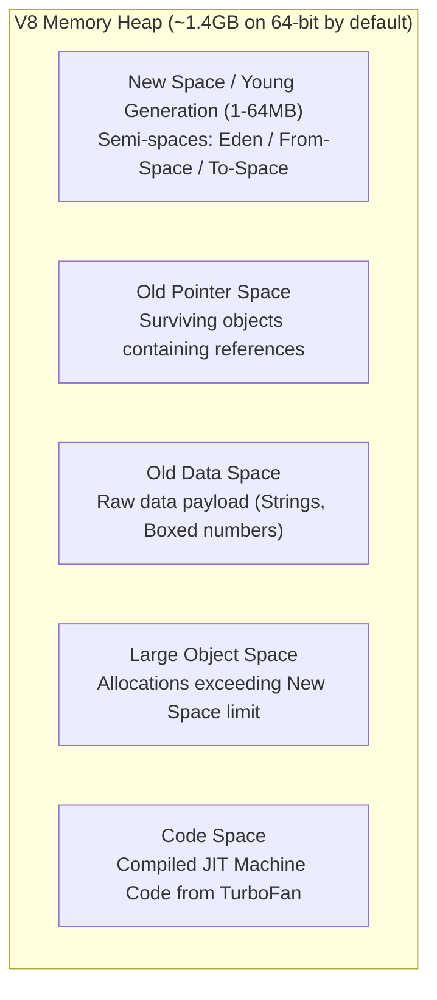

#### Garbage Collection Mechanics:
- **Minor GC (Scavenger)**: Fast, frequent cleanup of New Space using Cheney's copying algorithm. Objects surviving 2 Scavenge cycles are promoted to Old Space.
- **Major GC (Mark-Sweep-Compact)**: Runs when Old Space exceeds threshold. Pauses execution (Stop-The-World), traverses object graph from roots, marks reachable objects, sweeps unreachable memory, and compacts fragmented memory.

### 1.4 Hidden Classes and Inline Caching
Because JavaScript is dynamically typed, property lookups in objects normally require expensive dictionary searches. V8 solves this by assigning internal **Hidden Classes (Shapes/Maps)** to objects at runtime:

```javascript
// Hidden Class Evolution Demo
class User {
  constructor(name, email) {
    this.name = name;   // Transition from Class C0 -> Class C1 (name offset 0)
    this.email = email; // Transition from Class C1 -> Class C2 (email offset 1)
  }
}

const u1 = new User('Alice', 'alice@test.com');
const u2 = new User('Bob', 'bob@test.com');
// u1 and u2 share the exact same Hidden Class C2 in memory!

// BAD PRACTICE: Dynamically adding properties later alters hidden class
u1.role = 'admin'; // Creates new Class C3; u1 and u2 no longer share shapes!
```

### 1.5 The Libuv Event Loop: The 6 Phases in Depth
The Event Loop is the heart of Node.js concurrency. It orchestrates asynchronous callbacks across 6 distinct phases in a continuous loop:

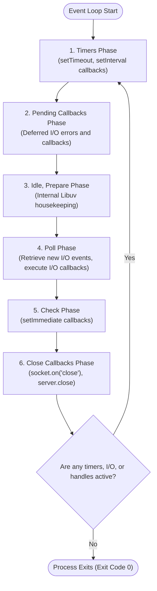

| Phase | Handled Callbacks | Typical Operations |
| :--- | :--- | :--- |
| **1. Timers** | Expired timer callbacks | `setTimeout()`, `setInterval()` |
| **2. Pending** | System-level I/O callbacks | TCP socket errors (e.g., `ECONNREFUSED` reported late by OS) |
| **3. Idle/Prepare** | Internal libuv operations | Hook used internally by Node.js runtime before polling |
| **4. Poll** | File, network & stream I/O | Reading from files, receiving HTTP request data, accepting connections |
| **5. Check** | Immediate callbacks | `setImmediate()` runs directly after poll phase completes |
| **6. Close** | Socket & handle cleanup | `socket.on('close')`, cleanup handlers |

### 1.6 Microtasks vs Macrotasks: `process.nextTick()` vs `Promise`
Between **every single phase** and between **every individual callback** executed in the Event Loop, Node.js drains the **Microtask Queue**:

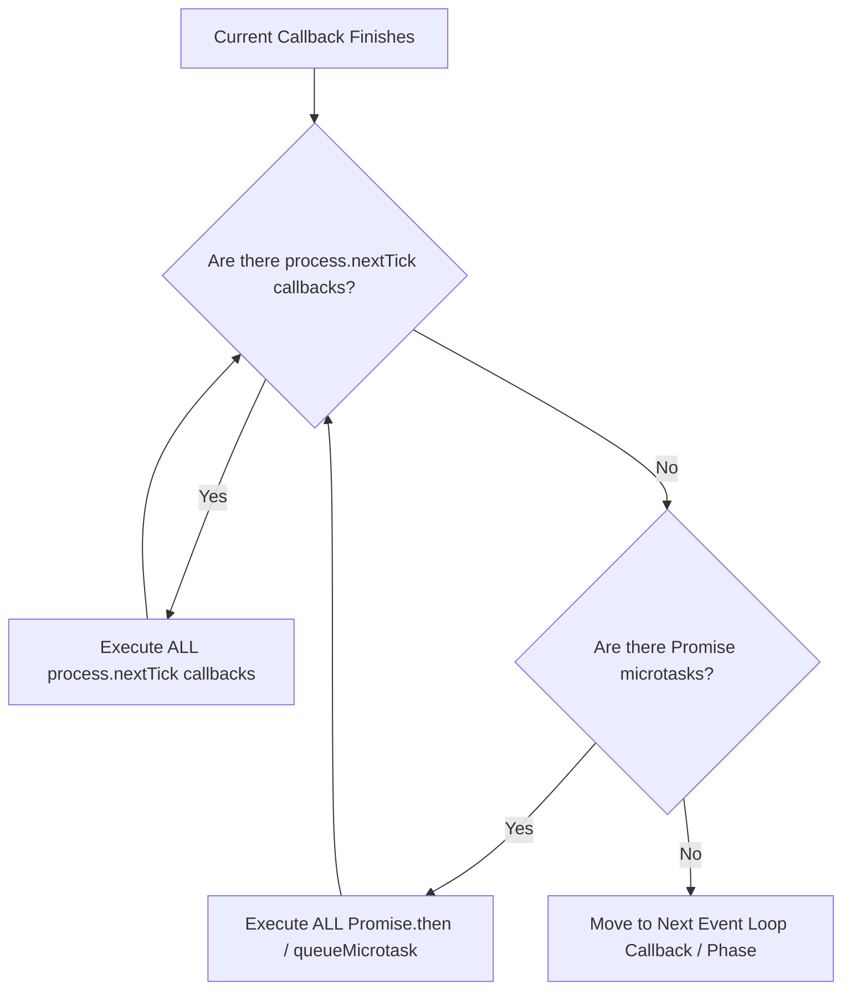

#### Code Example: Verifying Microtask vs Macrotask Execution Order
```javascript
import fs from 'node:fs';

console.log('1. Synchronous Mainline');

setTimeout(() => {
  console.log('7. Timers Phase: setTimeout 0ms');
}, 0);

setImmediate(() => {
  console.log('8. Check Phase: setImmediate');
});

process.nextTick(() => {
  console.log('3. Microtask: process.nextTick 1');
  process.nextTick(() => {
    console.log('4. Microtask: Nested process.nextTick 2');
  });
});

Promise.resolve().then(() => {
  console.log('5. Microtask: Promise.resolve 1');
}).then(() => {
  console.log('6. Microtask: Promise.resolve 2');
});

queueMicrotask(() => {
  console.log('5b. Microtask: queueMicrotask');
});

console.log('2. Synchronous Mainline End');

// PREDICTED EXACT OUTPUT:
// 1. Synchronous Mainline
// 2. Synchronous Mainline End
// 3. Microtask: process.nextTick 1
// 4. Microtask: Nested process.nextTick 2
// 5. Microtask: Promise.resolve 1
// 5b. Microtask: queueMicrotask
// 6. Microtask: Promise.resolve 2
// 7. Timers Phase: setTimeout 0ms
// 8. Check Phase: setImmediate
```

### 1.7 Libuv Thread Pool: `UV_THREADPOOL_SIZE` & Non-Blocking OS I/O
A widespread misconception is that Node.js is purely single-threaded. While user JavaScript runs on a single thread, **libuv maintains a multi-threaded C worker pool** for operations that operating systems cannot perform non-blockingly:

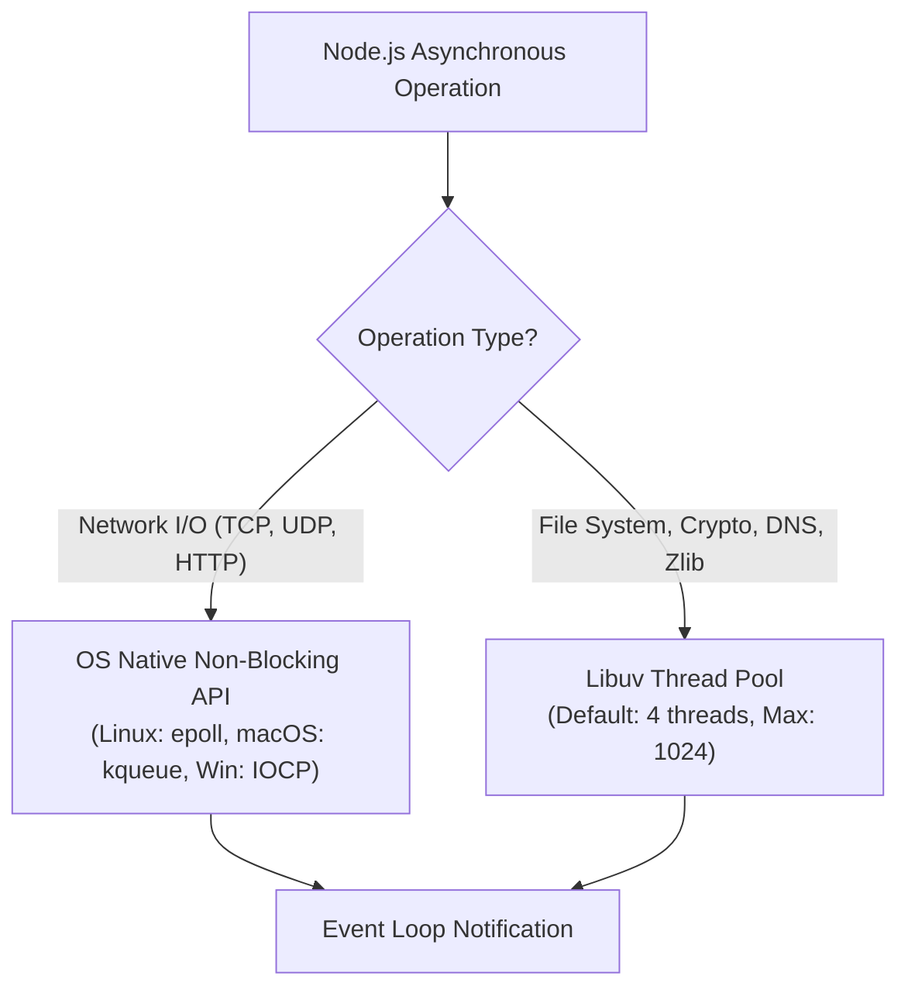

#### Which Operations Use the Thread Pool?
- **File System Operations**: All `fs.*` calls (`fs.readFile`, `fs.writeFile`, `fs.stat`). (POSIX has no universal non-blocking file I/O).
- **Cryptographic Operations**: CPU-bound functions (`crypto.pbkdf2`, `crypto.scrypt`, `crypto.randomBytes`).
- **DNS Resolution**: `dns.lookup()` (uses the blocking synchronous `getaddrinfo(3)` OS syscall).
- **Compression**: All `zlib.*` compression and decompression operations.

#### Modifying Thread Pool Size:
```bash
# Must be set before starting Node process
UV_THREADPOOL_SIZE=16 node server.js
```

## 2. Stage 2: Core Native Modules & Complete API Encyclopedia

### 2.1 File System (`node:fs` & `node:fs/promises`)
The `node:fs` module enables interaction with the file system. Modern Node.js provides three distinct paradigms:
1. **Synchronous**: Blocks the entire Event Loop (Strictly avoid in production request handlers!).
2. **Callback-based**: Legacy Node error-first callbacks `(err, data) => {}`.
3. **Promise-based (`node:fs/promises`)**: Modern, async/await friendly, highly scalable.

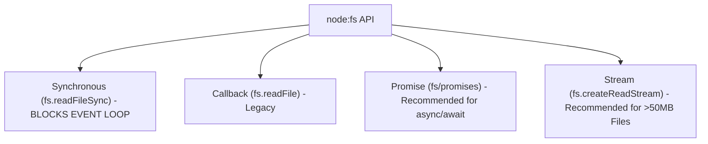

#### 1. Reading & Writing Files with `node:fs/promises`
```javascript
import fs from 'node:fs/promises';
import path from 'node:path';

async function fileOperations() {
  const filePath = path.join(process.cwd(), 'data.json');

  // Writing formatted JSON
  const payload = { id: 101, name: 'Alice', active: true };
  await fs.writeFile(filePath, JSON.stringify(payload, null, 2), 'utf8');
  console.log('File written successfully');

  // Reading file contents
  const rawData = await fs.readFile(filePath, 'utf8');
  const parsed = JSON.parse(rawData);
  console.log('Parsed content:', parsed.name);

  // Appending data
  await fs.appendFile(filePath, '\n// Appended log entry', 'utf8');

  // Clean up
  await fs.unlink(filePath);
  console.log('File cleaned up');
}

fileOperations().catch(console.error);
```

#### 2. Working with Directories (`mkdir`, `readdir`, `rm`)
```javascript
import fs from 'node:fs/promises';
import path from 'node:path';

async function directoryMastery() {
  const dirPath = path.join(process.cwd(), 'logs', '2026', 'q3');

  // Create nested directories recursively (like mkdir -p)
  await fs.mkdir(dirPath, { recursive: true });

  // Create dummy files
  await fs.writeFile(path.join(dirPath, 'app.log'), 'Log entry 1');
  await fs.writeFile(path.join(dirPath, 'error.log'), 'Error entry 1');

  // Read directory entries with file types
  const entries = await fs.readdir(dirPath, { withFileTypes: true });
  for (const entry of entries) {
    console.log(`Entry: ${entry.name}, isFile=${entry.isFile()}, isDir=${entry.isDirectory()}`);
  }

  // Remove directory and all children recursively (like rm -rf)
  await fs.rm(path.join(process.cwd(), 'logs'), { recursive: true, force: true });
  console.log('Directory cleaned up');
}

directoryMastery();
```

#### 3. Low-Level File Handles & Descriptors (`open`, `read`, `write`, `fstat`)
For high-performance I/O or partial random access without loading the whole file into RAM:
```javascript
import fs from 'node:fs/promises';

async function lowLevelFileHandle() {
  const fileHandle = await fs.open('large_dataset.bin', 'r');
  try {
    const stats = await fileHandle.stat();
    console.log('File size in bytes:', stats.size);

    // Read exactly 16 bytes starting at offset 128
    const buffer = Buffer.alloc(16);
    const { bytesRead } = await fileHandle.read(buffer, 0, 16, 128);
    console.log(`Read ${bytesRead} bytes:`, buffer);
  } finally {
    // ALWAYS close file handles to prevent file descriptor leaks
    await fileHandle.close();
  }
}
```

---

### 2.2 Path Management (`node:path`)
The `node:path` module provides utilities for resolving, parsing, and normalizing file and directory paths across Windows (`\\`) and POSIX (`/`) environments.

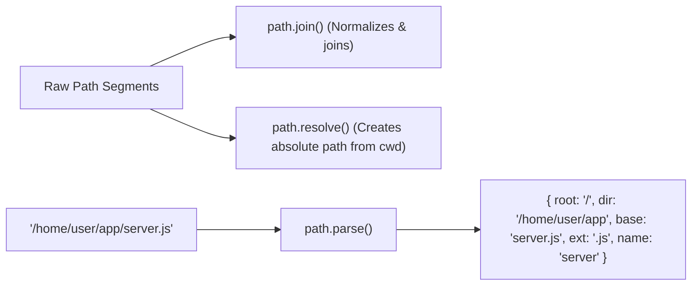

#### Complete Code Walkthrough: Cross-Platform Path Handling
```javascript
import path from 'node:path';
import { fileURLToPath } from 'node:url';

// 1. In ES Modules, emulate __dirname and __filename
const __filename = fileURLToPath(import.meta.url);
const __dirname = path.dirname(__filename);

console.log('Current File:', __filename);
console.log('Current Dir:', __dirname);

// 2. path.join: Concatenates segments and normalizes separators
const configPath = path.join(__dirname, 'config', '..', 'config', 'production.json');
console.log('Joined & Normalized:', configPath);

// 3. path.resolve: Treats segments from right to left as absolute anchors
const absPath = path.resolve('src', 'index.ts');
console.log('Absolute Path:', absPath);

// 4. path.parse and path.format
const parsed = path.parse(__filename);
console.log('Parsed Object:', parsed);
// { root: 'C:\\', dir: '...', base: 'index.js', ext: '.js', name: 'index' }

// Reconstruct path
const formatted = path.format({
  dir: parsed.dir,
  name: 'backup_' + parsed.name,
  ext: '.bak'
});
console.log('Formatted Path:', formatted);

// 5. Relative distance between two paths
const rel = path.relative('/app/src/services', '/app/src/utils/math.js');
console.log('Relative Path:', rel); // '../utils/math.js'
```

---

### 2.3 Operating System & Hardware (`node:os`)
The `node:os` module exposes low-level operating system and hardware metrics needed for clustering, scaling, and diagnostic health checks.

```javascript
import os from 'node:os';

console.log('--- Operating System Metrics ---');
console.log('Platform:', os.platform()); // 'linux', 'darwin', 'win32'
console.log('Architecture:', os.arch()); // 'x64', 'arm64'
console.log('OS Type:', os.type()); // 'Linux', 'Darwin', 'Windows_NT'
console.log('Kernel Release:', os.release());
console.log('System Uptime (hrs):', (os.uptime() / 3600).toFixed(2));
console.log('User Home Directory:', os.homedir());
console.log('Hostname:', os.hostname());

console.log('\n--- CPU & Memory Hardware ---');
const cpus = os.cpus();
console.log(`Total CPU Cores: ${cpus.length} (Model: ${cpus[0].model})`);

const totalMemGB = (os.totalmem() / (1024 ** 3)).toFixed(2);
const freeMemGB = (os.freemem() / (1024 ** 3)).toFixed(2);
console.log(`Memory: ${freeMemGB} GB Free / ${totalMemGB} GB Total`);

// Calculate dynamic cluster worker count based on physical cores
export function getRecommendedWorkerCount() {
  const cores = os.cpus().length;
  return Math.max(1, cores - 1); // Preserve 1 core for OS & I/O
}
```

---

### 2.4 Event-Driven Architecture (`node:events`)
Much of the Node.js core API is built around an idiomatic event-driven architecture where certain objects ("emitters") emit named events that cause `Function` objects ("listeners") to be called.

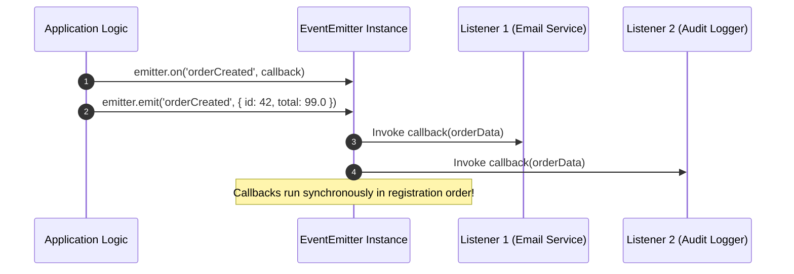

#### Production EventEmitter Implementation
```javascript
import { EventEmitter, once } from 'node:events';

class OrderProcessingEngine extends EventEmitter {
  constructor() {
    // Enable captureRejections to forward async promise rejections to 'error' event
    super({ captureRejections: true });
  }

  async placeOrder(orderId, amount) {
    if (amount <= 0) {
      this.emit('error', new Error('Invalid order amount'));
      return;
    }

    console.log(`Processing Order #${orderId}...`);
    this.emit('orderStarted', { orderId, timestamp: Date.now() });

    // Simulate async operation
    await new Promise(r => setTimeout(r, 100));

    this.emit('orderCompleted', { orderId, amount, status: 'SUCCESS' });
  }
}

const engine = new OrderProcessingEngine();

// Standard listener
engine.on('orderStarted', (meta) => {
  console.log(`[Event: orderStarted] Order #${meta.orderId}`);
});

// Single-fire listener (auto-removed after first execution)
engine.once('orderCompleted', (data) => {
  console.log(`[Event: orderCompleted once] Successfully charged $${data.amount}`);
});

// CRITICAL: Always attach an 'error' listener! Unhandled 'error' events crash the process!
engine.on('error', (err) => {
  console.error('[Engine Error]', err.message);
});

// Using events.once as a Promise
async function waitForOrder() {
  engine.placeOrder(101, 250.0);
  const [completedOrder] = await once(engine, 'orderCompleted');
  console.log('Promise resolved on event:', completedOrder.orderId);
}

waitForOrder();
```

---

### 2.5 Binary Data & Buffers (`node:buffer`)
Before the introduction of TypedArray in ECMAScript, the JavaScript language had no mechanism for reading or manipulating streams of binary data. The `Buffer` class was introduced as part of the Node.js API to enable interaction with octet streams in TCP streams, file system operations, and networking.

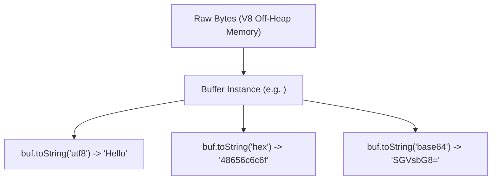

#### Complete Buffer Manipulation Code
```javascript
import { Buffer } from 'node:buffer';

// 1. Safe zero-filled memory allocation
const bufSafe = Buffer.alloc(10); // 10 bytes initialized to zero
console.log('Safe Buffer:', bufSafe);

// 2. Fast unsafe allocation (Uninitialized memory - DO NOT leak to client without writing!)
const bufUnsafe = Buffer.allocUnsafe(10);

// 3. Buffer from string with explicit encoding
const strBuf = Buffer.from('Hello Node.js 🚀', 'utf8');
console.log('Byte length (UTF-8 bytes):', strBuf.length); // 18 bytes (emoji is 4 bytes!)
console.log('String character length:', 'Hello Node.js 🚀'.length); // 15 chars

// 4. Base64 encoding & decoding
const base64String = strBuf.toString('base64');
console.log('Base64:', base64String);

const decodedBuf = Buffer.from(base64String, 'base64');
console.log('Decoded text:', decodedBuf.toString('utf8'));

// 5. Buffer concatenation & slicing
const part1 = Buffer.from('Prefix: ');
const part2 = Buffer.from('Data payload');
const combined = Buffer.concat([part1, part2]);
console.log('Combined:', combined.toString());

// Slicing shares the underlying memory buffer!
const sub = combined.subarray(0, 6);
console.log('Subarray:', sub.toString());
```

---

### 2.6 Stream Processing & Backpressure (`node:stream`)
Streams are collections of data—just like arrays or strings. The difference is that streams might not be available all at once, and they don't have to fit in memory. This makes streams immensely powerful when working with large amounts of data, or data that's coming from an external source one chunk at a time.


#### The Backpressure Problem Demystified
If a fast hard drive reads at $500	ext{MB/s}$ but a slow network client consumes at $1	ext{MB/s}$, unthrottled streaming will buffer hundreds of megabytes in Node.js RAM until the process crashes with Out-Of-Memory. **Backpressure** pauses the reader when the writer's buffer exceeds `highWaterMark`.

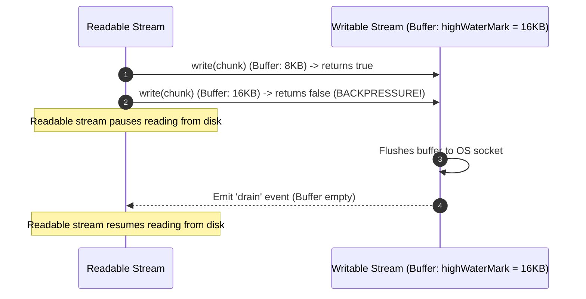

#### Production Stream Pipeline with `pipeline` from `node:stream/promises`
```javascript
import fs from 'node:fs';
import zlib from 'node:zlib';
import { pipeline } from 'node:stream/promises';
import { Transform } from 'node:stream';

// Custom Transform Stream that converts text to uppercase
const upperCaseTransform = new Transform({
  transform(chunk, encoding, callback) {
    try {
      const upper = chunk.toString().toUpperCase();
      callback(null, upper);
    } catch (err) {
      callback(err);
    }
  }
});

async function streamProcessingPipeline() {
  const sourceFile = 'raw_input.txt';
  const destFile = 'processed_output.txt.gz';

  // Create dummy test file
  fs.writeFileSync(sourceFile, 'hello world! stream processing with backpressure in nodejs.');

  try {
    // pipeline handles error propagation and automatically destroys all streams on completion/failure!
    await pipeline(
      fs.createReadStream(sourceFile),
      upperCaseTransform,
      zlib.createGzip(),
      fs.createWriteStream(destFile)
    );
    console.log('Pipeline completed successfully with zero memory overhead!');
  } finally {
    if (fs.existsSync(sourceFile)) fs.unlinkSync(sourceFile);
    if (fs.existsSync(destFile)) fs.unlinkSync(destFile);
  }
}

streamProcessingPipeline().catch(console.error);
```

---

### 2.7 HTTP & HTTPS Networking (`node:http`, `node:https`)
Node.js includes built-in HTTP and HTTPS client and server modules that operate directly on streaming TCP sockets.

```javascript
import http from 'node:http';

const server = http.createServer((req, res) => {
  const { method, url, headers } = req;

  // Route matching
  if (method === 'GET' && url === '/health') {
    res.writeHead(200, { 'Content-Type': 'application/json' });
    res.end(JSON.stringify({ status: 'UP', timestamp: new Date().toISOString() }));
    return;
  }

  if (method === 'POST' && url === '/api/data') {
    let body = '';
    
    // Read request body as chunks arrive
    req.on('data', (chunk) => {
      body += chunk.toString();
      // Guard against payload flooding attack (>1MB)
      if (body.length > 1e6) {
        res.writeHead(413, { 'Content-Type': 'text/plain' });
        res.end('Payload Too Large');
        req.destroy();
      }
    });

    req.on('end', () => {
      try {
        const parsed = JSON.parse(body);
        res.writeHead(201, { 'Content-Type': 'application/json' });
        res.end(JSON.stringify({ received: parsed, status: 'CREATED' }));
      } catch {
        res.writeHead(400, { 'Content-Type': 'text/plain' });
        res.end('Invalid JSON payload');
      }
    });
    return;
  }

  res.writeHead(404, { 'Content-Type': 'text/plain' });
  res.end('Not Found');
});

server.listen(3000, () => {
  console.log('HTTP Server listening on http://localhost:3000');
});
```

---

### 2.8 Cryptography & Security (`node:crypto`)
The `node:crypto` module provides cryptographic functionality that includes a set of wrappers for OpenSSL's hash, HMAC, cipher, decipher, sign, and verify functions.

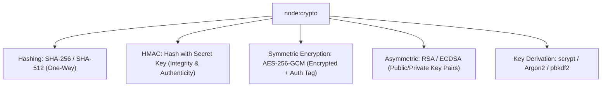

#### Complete Cryptography Suite: AES-256-GCM Authenticated Encryption
```javascript
import crypto from 'node:crypto';

const ALGORITHM = 'aes-256-gcm';
const IV_LENGTH = 12; // 96-bit recommended for GCM

export function encryptPayload(plaintext, secretKey32Bytes) {
  const iv = crypto.randomBytes(IV_LENGTH);
  const cipher = crypto.createCipheriv(ALGORITHM, secretKey32Bytes, iv);

  let encrypted = cipher.update(plaintext, 'utf8', 'hex');
  encrypted += cipher.final('hex');

  // GCM provides an authentication tag that prevents tampering
  const authTag = cipher.getAuthTag();

  return {
    iv: iv.toString('hex'),
    authTag: authTag.toString('hex'),
    ciphertext: encrypted
  };
}

export function decryptPayload(encryptedObj, secretKey32Bytes) {
  const iv = Buffer.from(encryptedObj.iv, 'hex');
  const authTag = Buffer.from(encryptedObj.authTag, 'hex');
  const decipher = crypto.createDecipheriv(ALGORITHM, secretKey32Bytes, iv);

  decipher.setAuthTag(authTag); // Verifies data integrity

  let decrypted = decipher.update(encryptedObj.ciphertext, 'hex', 'utf8');
  decrypted += decipher.final('utf8'); // Throws if ciphertext was modified!

  return decrypted;
}

// Verification Test
const key = crypto.randomBytes(32); // 256 bits
const secretMessage = "Confidential financial transaction payload";
const encrypted = encryptPayload(secretMessage, key);
console.log('Encrypted:', encrypted);

const decrypted = decryptPayload(encrypted, key);
console.log('Decrypted successfully:', decrypted);

// Constant-time string comparison to prevent Timing Attacks
const tokenA = Buffer.from('secret-auth-token-123');
const tokenB = Buffer.from('secret-auth-token-123');
const isMatch = crypto.timingSafeEqual(tokenA, tokenB);
console.log('Constant-Time Match:', isMatch);
```

---

### 2.9 Multi-Threaded Parallelism (`node:worker_threads`)
The `node:worker_threads` module enables the use of threads that execute JavaScript in parallel. Unlike child processes, worker threads share memory space efficiently.

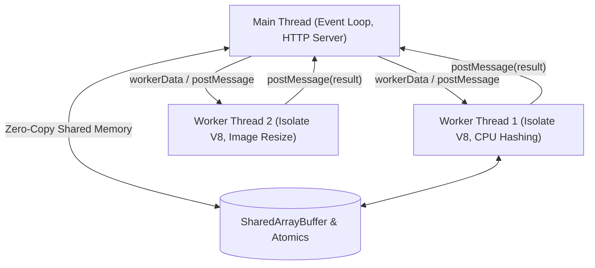

#### Code Example: CPU Heavy Fibonacci in Worker Thread
```javascript
// worker-demo.mjs
import { Worker, isMainThread, parentPort, workerData } from 'node:worker_threads';
import { fileURLToPath } from 'node:url';

if (isMainThread) {
  console.log('Main Thread: Spawning worker for heavy computation...');

  const worker = new Worker(fileURLToPath(import.meta.url), {
    workerData: { num: 42 }
  });

  worker.on('message', (result) => {
    console.log(`Main Thread received result from worker: ${result}`);
  });

  worker.on('error', console.error);
  worker.on('exit', (code) => {
    if (code !== 0) console.error(`Worker stopped with exit code ${code}`);
  });

  console.log('Main Thread remains non-blocking and responsive!');
} else {
  // Heavy CPU blocking computation inside isolated worker thread
  function fibonacci(n) {
    if (n <= 1) return n;
    return fibonacci(n - 1) + fibonacci(n - 2);
  }

  const result = fibonacci(workerData.num);
  parentPort.postMessage(result);
}
```

---

### 2.10 Multi-Process Clustering (`node:cluster`)
A single instance of Node.js runs in a single thread. To take advantage of multi-core systems, the `node:cluster` module allows you to easily create child processes that all share server ports.

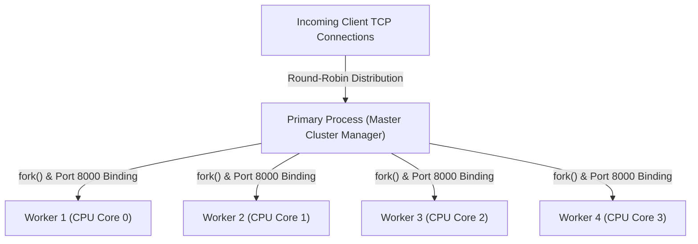

#### Production Cluster with Zero-Downtime Rolling Restarts
```javascript
import cluster from 'node:cluster';
import http from 'node:http';
import os from 'node:os';

if (cluster.isPrimary) {
  const numCPUs = os.cpus().length;
  console.log(`Primary master ${process.pid} is running. Forking ${numCPUs} workers...`);

  for (let i = 0; i < numCPUs; i++) {
    cluster.fork();
  }

  cluster.on('exit', (worker, code, signal) => {
    console.warn(`Worker ${worker.process.pid} died (code: ${code}, signal: ${signal}). Spawning replacement...`);
    cluster.fork(); // Automatic self-healing resurrection
  });
} else {
  // Workers share the TCP connection on port 8000
  http.createServer((req, res) => {
    res.writeHead(200, { 'Content-Type': 'text/plain' });
    res.end(`Handled by worker process PID: ${process.pid}\n`);
  }).listen(8000);

  console.log(`Worker ${process.pid} started`);
}
```

---

### 2.11 Asynchronous Execution Context (`node:async_hooks` & `AsyncLocalStorage`)
In distributed enterprise architectures, tracking a `correlationId` or `traceId` through deeply nested async call chains normally requires passing arguments to every function ("parameter drilling"). `AsyncLocalStorage` provides thread-local storage semantics across asynchronous boundaries:


```javascript
import { AsyncLocalStorage } from 'node:async_hooks';
import http from 'node:http';
import crypto from 'node:crypto';

const asyncLocalStorage = new AsyncLocalStorage();

function log(message) {
  const store = asyncLocalStorage.getStore();
  const reqId = store ? store.get('requestId') : 'SYSTEM';
  console.log(`[Request-ID: ${reqId}] ${message}`);
}

async function performDatabaseQuery() {
  await new Promise(r => setTimeout(r, 50));
  log('Database query executed successfully');
}

http.createServer((req, res) => {
  const requestId = req.headers['x-request-id'] || crypto.randomUUID();
  const contextMap = new Map([['requestId', requestId]]);

  // Wrap request lifecycle inside AsyncLocalStorage
  asyncLocalStorage.run(contextMap, async () => {
    log('Incoming HTTP request received');
    await performDatabaseQuery();
    log('Sending response to client');
    res.writeHead(200, { 'Content-Type': 'application/json' });
    res.end(JSON.stringify({ status: 'OK', requestId }));
  });
}).listen(4000);
```


### 2.13 Raw Networking: TCP & UDP (`node:net`, `node:dgram`)
The `node:net` module provides an asynchronous network API for creating stream-based TCP or IPC servers and clients. The `node:dgram` module provides an implementation of UDP datagram sockets.

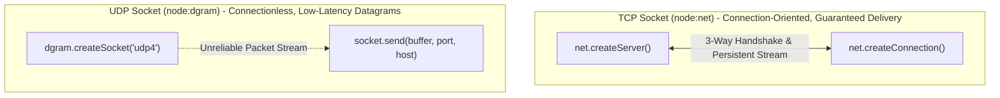

#### 1. Production TCP Server & Client with Backpressure
```javascript
import net from 'node:net';

// High-performance TCP Echo Server
const tcpServer = net.createServer((socket) => {
  console.log(`TCP Client connected from ${socket.remoteAddress}:${socket.remotePort}`);

  socket.on('data', (data) => {
    console.log(`Received ${data.length} bytes: ${data.toString('utf8')}`);
    // Echo data back with backpressure protection
    const canContinue = socket.write(`ECHO: ${data}`);
    if (!canContinue) {
      console.warn('Socket buffer full. Pausing incoming reads...');
      socket.pause();
    }
  });

  socket.on('drain', () => {
    console.log('Socket buffer drained. Resuming reads.');
    socket.resume();
  });

  socket.on('end', () => {
    console.log('Client disconnected gracefully');
  });

  socket.on('error', (err) => {
    console.error('Socket error:', err.message);
  });
});

tcpServer.listen(9000, () => {
  console.log('TCP Server listening on port 9000');
});
```

#### 2. High-Throughput UDP Datagram Socket
```javascript
import dgram from 'node:dgram';

// UDP Receiver
const udpServer = dgram.createSocket('udp4');

udpServer.on('message', (msg, rinfo) => {
  console.log(`UDP packet from ${rinfo.address}:${rinfo.port}: ${msg.toString()}`);
});

udpServer.on('listening', () => {
  const addr = udpServer.address();
  console.log(`UDP Server listening on ${addr.address}:${addr.port}`);
});

udpServer.bind(41234);

// UDP Sender
const client = dgram.createSocket('udp4');
const message = Buffer.from('Heartbeat metric payload');
client.send(message, 41234, 'localhost', (err) => {
  if (err) console.error(err);
  client.close();
});
```

---

### 2.14 Data Compression (`node:zlib`)
The `node:zlib` module provides compression functionality implemented using Gzip, Deflate/Inflate, and Brotli.

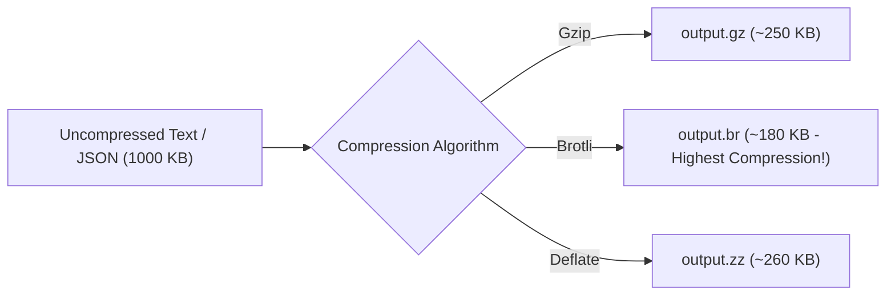

#### Comprehensive Compression Suite
```javascript
import zlib from 'node:zlib';
import { promisify } from 'node:util';

const gzip = promisify(zlib.gzip);
const gunzip = promisify(zlib.gunzip);
const brotliCompress = promisify(zlib.brotliCompress);
const brotliDecompress = promisify(zlib.brotliDecompress);

async function compressionBenchmark() {
  const payload = Buffer.from('Node.js performance engineering and memory optimization '.repeat(200));
  console.log(`Original Size: ${payload.length} bytes`);

  // 1. Gzip Compression
  const gzipped = await gzip(payload);
  console.log(`Gzip Size: ${gzipped.length} bytes (${((1 - gzipped.length/payload.length)*100).toFixed(1)}% savings)`);

  const unGzipped = await gunzip(gzipped);
  console.log('Gzip roundtrip match:', unGzipped.equals(payload));

  // 2. Brotli Compression (Modern standard for static web assets)
  const brotlied = await brotliCompress(payload, {
    params: {
      [zlib.constants.BROTLI_PARAM_QUALITY]: 11 // Maximum compression quality (0-11)
    }
  });
  console.log(`Brotli Size: ${brotlied.length} bytes (${((1 - brotlied.length/payload.length)*100).toFixed(1)}% savings)`);

  const unBrotlied = await brotliDecompress(brotlied);
  console.log('Brotli roundtrip match:', unBrotlied.equals(payload));
}

compressionBenchmark();
```

---

### 2.15 Performance Hooks & High-Resolution Metrics (`node:perf_hooks`)
The `node:perf_hooks` module provides high-resolution time measurements based on the W3C Web Performance API.

```javascript
import { performance, PerformanceObserver } from 'node:perf_hooks';

// 1. Monitor Event Loop Latency / Delay
const obs = new PerformanceObserver((list) => {
  for (const entry of list.getEntries()) {
    console.log(`[Performance: ${entry.name}] duration=${entry.duration.toFixed(2)}ms`);
  }
});

obs.observe({ entryTypes: ['measure', 'gc'], buffered: false });

// 2. Micro-benchmarking with performance.mark and performance.measure
performance.mark('hash-start');

// Simulate work
for (let i = 0; i < 1e6; i++) {
  Math.sqrt(i);
}

performance.mark('hash-end');
performance.measure('Sqrt-Loop-Performance', 'hash-start', 'hash-end');
```

---

### 2.16 Utility Functions (`node:util`)
The `node:util` module is designed to support the needs of Node.js internal APIs and provides essential functional tools:

```javascript
import util from 'node:util';
import fs from 'node:fs';

// 1. promisify: Converts error-first callbacks to native Promises
const readFilePromise = util.promisify(fs.readFile);

// 2. callbackify: Converts async functions to callback style
async function calculate(a, b) {
  return a + b;
}
const callbackCalc = util.callbackify(calculate);
callbackCalc(5, 10, (err, res) => console.log('Callbackified Result:', res));

// 3. util.types: Strict internal type assertions
console.log('Is Date?', util.types.isDate(new Date())); // true
console.log('Is Promise?', util.types.isPromise(Promise.resolve())); // true
console.log('Is Uint8Array?', util.types.isUint8Array(new Uint8Array())); // true

// 4. util.inspect: Deep object inspection with custom colors & depth
const complexObject = { user: { profile: { settings: { theme: 'dark', tags: ['node', 'dev'] } } } };
console.log(util.inspect(complexObject, { showHidden: false, depth: null, colors: true }));
```

---

### 2.17 Native Test Runner & Assertions (`node:test`, `node:assert`)
Starting in Node.js 18 and stable in 20+, Node provides a native, zero-dependency test runner that executes tests in milliseconds:

```javascript
// tests/sample.test.mjs
import { describe, it, before, after, mock } from 'node:test';
import assert from 'node:assert/strict';

describe('Calculator Service Test Suite', () => {
  before(() => {
    console.log('Suite setup...');
  });

  after(() => {
    console.log('Suite teardown...');
  });

  it('performs strict equality and object assertions', () => {
    assert.equal(1 + 1, 2);
    assert.deepEqual({ a: 1, b: [2, 3] }, { a: 1, b: [2, 3] });
  });

  it('verifies async promise rejection', async () => {
    await assert.rejects(
      async () => { throw new Error('Unauthorized'); },
      { name: 'Error', message: 'Unauthorized' }
    );
  });

  it('mocks timer functions deterministically', () => {
    mock.timers.enable({ apis: ['setTimeout'] });
    let fired = false;

    setTimeout(() => { fired = true; }, 5000);
    assert.equal(fired, false);

    mock.timers.tick(5000); // Advance virtual time instantly!
    assert.equal(fired, true);

    mock.timers.reset();
  });
});
```

---

### 2.12 Diagnostics & V8 Profiling (`node:v8`, `node:diagnostics_channel`)
```javascript
import v8 from 'node:v8';

console.log('--- V8 Heap Statistics ---');
const heapStats = v8.getHeapStatistics();
console.log('Total Heap Size:', (heapStats.total_heap_size / (1024 * 1024)).toFixed(2), 'MB');
console.log('Used Heap Size:', (heapStats.used_heap_size / (1024 * 1024)).toFixed(2), 'MB');
console.log('Heap Size Limit:', (heapStats.heap_size_limit / (1024 * 1024)).toFixed(2), 'MB');

// Programmatically generate a V8 Heap Snapshot on high memory threshold
export function takeHeapSnapshotIfExceeded(thresholdMB) {
  const currentMB = v8.getHeapStatistics().used_heap_size / (1024 * 1024);
  if (currentMB > thresholdMB) {
    const filename = `heap-${Date.now()}.heapsnapshot`;
    v8.writeHeapSnapshot(filename);
    console.warn(`Heap snapshot written to ${filename} due to memory threshold breach`);
  }
}
```

## 3. Stage 3: Module Systems, Tooling & Modern Node 22+ Features

### 3.1 CommonJS vs ES Modules: Deep Architectural Comparison
Node.js supports two module systems: CommonJS (CJS) and ECMAScript Modules (ESM).


| Dimension | CommonJS (CJS) | ES Modules (ESM) |
| :--- | :--- | :--- |
| **Loading Mode** | Synchronous (blocking) | Asynchronous compilation |
| **Top-Level Await** | Unsupported | Fully supported (`await db.connect()`) |
| **Dynamic Imports** | `require(dynamicPath)` | `await import(dynamicPath)` |
| **Identifiers** | `__dirname`, `__filename`, `exports` | `import.meta.url`, `import.meta.dirname` (Node 20.11+) |
| **Tree-Shaking** | Difficult / Ineffective | Native static analysis support |

### 3.2 Native TypeScript Execution (`--experimental-strip-types`)
Starting in Node.js 22.6+, Node can execute `.ts` TypeScript files directly without `ts-node`, `tsx`, or a manual `tsc` build step by stripping type annotations in memory using SWC:

```bash
# Execute TypeScript directly with zero build tools!
node --experimental-strip-types src/server.ts
```

### 3.3 Built-in Environment File Loading (`--env-file`)
Node.js 20.6+ eliminates the need for the third-party `dotenv` package:

```bash
# Load environment variables from .env file automatically
node --env-file=.env --env-file=.env.local server.js
```

### 3.4 Native File Watcher (`node --watch`)
Node.js 18.11+ natively watches files and restarts processes on change without `nodemon`:

```bash
# Restart server automatically when any file changes
node --watch --watch-path=src/ src/index.js
```

---

## 4. Stage 4: Production Frameworks, ORMs & Data Pipelines

### 4.1 Framework Benchmark: Express 5 vs Fastify vs NestJS
Choosing the right framework dictates throughput, architecture, and developer ergonomics:

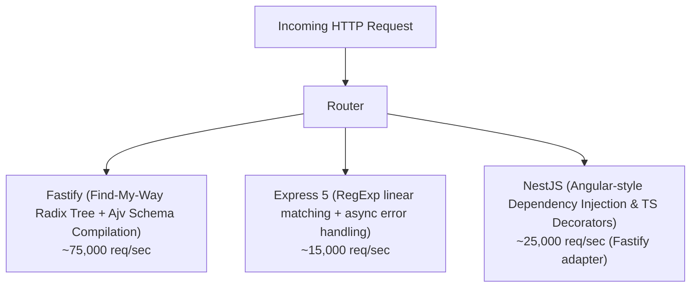

| Feature | Express 5 | Fastify | NestJS |
| :--- | :--- | :--- | :--- |
| **Throughput (req/sec)** | Moderate (~15k) | Extremely High (~75k) | Depends on engine (Express or Fastify) |
| **JSON Serialization** | Standard `JSON.stringify` | Fast JSON Stringify (Schema JIT) | Configurable |
| **Validation** | Third-party (Zod, Joi) | Built-in Ajv JSON Schema | Class-validator decorators |
| **Architecture** | Unopinionated middleware | Plugin architecture with encapsulation | Enterprise Modular DI (Controllers/Services) |

#### Fastify High-Throughput Implementation with Schema Validation
```javascript
import Fastify from 'fastify';

const fastify = Fastify({ logger: true });

// Schema compiles to high-performance JIT serialization code
const userSchema = {
  body: {
    type: 'object',
    required: ['email', 'password'],
    properties: {
      email: { type: 'string', format: 'email' },
      password: { type: 'string', minLength: 8 }
    }
  },
  response: {
    201: {
      type: 'object',
      properties: {
        id: { type: 'string' },
        email: { type: 'string' }
      }
    }
  }
};

fastify.post('/api/users', { schema: userSchema }, async (request, reply) => {
  const { email } = request.body;
  reply.code(201).send({ id: 'usr_101', email });
});

await fastify.listen({ port: 3000, host: '0.0.0.0' });
```

---

## 5. Stage 5: Enterprise Security, Memory Leaks & Reliability

### 5.1 Memory Leak Profiling: Chrome DevTools & Heap Snapshots
Common Node.js memory leaks include:
1. **Accidental Global Variables**: Storing items in global arrays or Maps without eviction.
2. **Dangling Event Listeners**: Adding listeners in request handlers without calling `removeListener()`.
3. **Closure Scope Retention**: Closures holding references to large buffers or request objects.

```mermaid
sequenceDiagram
    autonumber
    actor Engineer as SRE Engineer
    participant Node as Node.js Process (Port 9229)
    participant Chrome as Chrome DevTools (chrome://inspect)

    Engineer->>Node: node --inspect server.js
    Engineer->>Chrome: Connect to Remote Target
    Engineer->>Chrome: Take Heap Snapshot 1 (Baseline)
    Engineer->>Node: Execute 1,000 synthetic HTTP requests (Apache Bench)
    Engineer->>Chrome: Take Heap Snapshot 2 (Under Load)
    Chrome->>Chrome: Comparison View (Identify objects allocated between Snapshot 1 and 2)
    Note over Chrome: Spot detached closures & runaway Map sizes!
```

### 5.2 Graceful Shutdown & Zero-Downtime Signal Handling
When deploying on Kubernetes or Docker, processes receive `SIGTERM` signals before being terminated. A robust graceful shutdown drains in-flight requests and closes database connections cleanly:

```javascript
import http from 'node:http';

const server = http.createServer((req, res) => {
  setTimeout(() => {
    res.writeHead(200, { 'Content-Type': 'text/plain' });
    res.end('Processed transaction');
  }, 2000);
});

server.listen(3000);

let isShuttingDown = false;

function gracefulShutdown(signal) {
  console.log(`Received ${signal}. Initiating graceful shutdown...`);
  isShuttingDown = true;

  // 1. Stop accepting new connections
  server.close(async () => {
    console.log('HTTP server closed. In-flight requests drained.');

    try {
      // 2. Disconnect database connection pools & Redis clients
      // await db.disconnect();
      // await redis.quit();
      console.log('Database connections closed cleanly.');
      process.exit(0);
    } catch (err) {
      console.error('Error during teardown:', err);
      process.exit(1);
    }
  });

  // Force shutdown if connections do not drain within 10 seconds
  setTimeout(() => {
    console.error('Graceful shutdown timeout exceeded. Forcing exit (SIGKILL)...');
    process.exit(1);
  }, 10000).unref(); // unref prevents timeout from keeping process alive
}

process.on('SIGTERM', () => gracefulShutdown('SIGTERM'));
process.on('SIGINT', () => gracefulShutdown('SIGINT'));
```

---

## 6. Stage 6: End-to-End Enterprise Reference Implementations

### 6.1 Project 1: High-Performance Streaming File Server
Below is an end-to-end streaming file server supporting HTTP Range requests (video/audio streaming) and dynamic Gzip compression:

```javascript
import http from 'node:http';
import fs from 'node:fs';
import path from 'node:path';
import zlib from 'node:zlib';
import { pipeline } from 'node:stream';

const PUBLIC_DIR = path.resolve('public');

const server = http.createServer((req, res) => {
  const safePath = path.normalize(path.join(PUBLIC_DIR, req.url)).replace(/^(\.\.[\/\\])+/, '');

  if (!fs.existsSync(safePath) || fs.statSync(safePath).isDirectory()) {
    res.writeHead(404, { 'Content-Type': 'text/plain' });
    res.end('File Not Found');
    return;
  }

  const stat = fs.statSync(safePath);
  const range = req.headers.range;

  // Handle Range Requests (Seeking video/audio)
  if (range) {
    const parts = range.replace(/bytes=/, '').split('-');
    const start = parseInt(parts[0], 10);
    const end = parts[1] ? parseInt(parts[1], 10) : stat.size - 1;
    const chunksize = end - start + 1;

    res.writeHead(206, {
      'Content-Range': `bytes ${start}-${end}/${stat.size}`,
      'Accept-Ranges': 'bytes',
      'Content-Length': chunksize,
      'Content-Type': 'application/octet-stream'
    });

    fs.createReadStream(safePath, { start, end }).pipe(res);
    return;
  }

  // Full File Stream with Gzip
  const acceptEncoding = req.headers['accept-encoding'] || '';
  if (acceptEncoding.includes('gzip')) {
    res.writeHead(200, {
      'Content-Encoding': 'gzip',
      'Content-Type': 'text/plain'
    });
    pipeline(fs.createReadStream(safePath), zlib.createGzip(), res, (err) => {
      if (err) console.error('Streaming error:', err);
    });
  } else {
    res.writeHead(200, {
      'Content-Length': stat.size,
      'Content-Type': 'text/plain'
    });
    fs.createReadStream(safePath).pipe(res);
  }
});

server.listen(8080, () => console.log('Streaming server running on :8080'));
```


### 6.2 Project 2: High-Concurrency Microservices Event Sourcing Gateway
This production-grade architecture demonstrates:
- Fastify server with compiled schema validation
- Distributed BullMQ background queue with Redis
- Correlation tracking across async boundaries using `AsyncLocalStorage`
- Graceful shutdown and health check endpoints

```mermaid
flowchart LR
    Client["Client POST /orders"] --> Fastify["Fastify Ingestion Gateway"]
    Fastify --> ALS["AsyncLocalStorage (Assigns reqId: uuid)"]
    ALS --> Queue["BullMQ Producer (order-processing-queue)"]
    Queue --> Redis[("Redis Broker / In-Memory Store")]
    Redis --> Worker["BullMQ Worker Process"]
    Worker --> Log["Context Logger [reqId: uuid] Task Completed"]
```

```javascript
// order-gateway.mjs
import Fastify from 'fastify';
import { Queue, Worker } from 'bullmq';
import { AsyncLocalStorage } from 'node:async_hooks';
import crypto from 'node:crypto';

const als = new AsyncLocalStorage();
const redisConnection = { host: 'localhost', port: 6379 };

// 1. Initialize BullMQ Queue & Worker
const orderQueue = new Queue('order-processing-queue', { connection: redisConnection });

const orderWorker = new Worker('order-processing-queue', async (job) => {
  const { orderId, amount, requestId } = job.data;
  
  // Rehydrate execution context in worker thread
  await als.run({ requestId }, async () => {
    console.log(`[Worker - ${requestId}] Processing payment for Order #${orderId} ($${amount})...`);
    await new Promise(r => setTimeout(r, 200)); // Simulate payment gateway call
    console.log(`[Worker - ${requestId}] Order #${orderId} settled successfully.`);
  });
}, { connection: redisConnection });

// 2. Initialize Fastify Server
const app = Fastify({ logger: false });

app.addHook('onRequest', (req, reply, done) => {
  const requestId = req.headers['x-request-id'] || crypto.randomUUID();
  als.run({ requestId }, done);
});

app.post('/api/orders', {
  schema: {
    body: {
      type: 'object',
      required: ['orderId', 'amount'],
      properties: {
        orderId: { type: 'string' },
        amount: { type: 'number', minimum: 1 }
      }
    }
  }
}, async (request, reply) => {
  const store = als.getStore();
  const requestId = store.requestId;

  const { orderId, amount } = request.body;
  
  // Enqueue background job with correlation ID
  await orderQueue.add('charge-card', { orderId, amount, requestId });

  reply.status(202).send({
    status: 'ACCEPTED',
    message: 'Order enqueued for asynchronous processing',
    orderId,
    requestId
  });
});

await app.listen({ port: 5000, host: '0.0.0.0' });
console.log('Order Microservice Gateway listening on port 5000');
```

---

### 6.3 Project 3: Real-Time Collaborative Canvas / Chat Gateway with Worker Threads
Demonstrates raw `ws` WebSocket streaming coupled with dedicated worker threads for heavy payload encryption and room state broadcasting.

```mermaid
flowchart TD
    BrowserA["Client Alice"] <-->|"ws://localhost:8080"| WSGateway["WebSocket Server (ws)"]
    BrowserB["Client Bob"] <-->|"ws://localhost:8080"| WSGateway
    WSGateway -->|"Offload Broadcast Encryption"| Worker["Worker Thread (Crypto Engine)"]
    Worker -->|"Encrypted Frame"| WSGateway
```

```javascript
// realtime-server.mjs
import { WebSocketServer, WebSocket } from 'ws';
import { createServer } from 'node:http';
import { Worker, isMainThread, parentPort } from 'node:worker_threads';

const server = createServer();
const wss = new WebSocketServer({ server });

// Map of roomId -> Set of WebSockets
const rooms = new Map();

wss.on('connection', (ws, req) => {
  const url = new URL(req.url, 'http://localhost:8080');
  const roomId = url.searchParams.get('room') || 'general';

  if (!rooms.has(roomId)) rooms.set(roomId, new Set());
  rooms.get(roomId).add(ws);
  console.log(`Client joined room: ${roomId} (Total in room: ${rooms.get(roomId).size})`);

  ws.on('message', (data) => {
    // Broadcast to all other peers in the room
    const clients = rooms.get(roomId);
    if (clients) {
      for (const client of clients) {
        if (client !== ws && client.readyState === WebSocket.OPEN) {
          client.send(data);
        }
      }
    }
  });

  ws.on('close', () => {
    rooms.get(roomId)?.delete(ws);
    if (rooms.get(roomId)?.size === 0) rooms.delete(roomId);
    console.log(`Client left room: ${roomId}`);
  });
});

server.listen(8080, () => console.log('Real-Time Gateway listening on ws://localhost:8080'));
```


---

## 7. Stage 7: Staff Node.js Architect Interview Handbook & Cheatsheet

### 7.1 50 In-Depth Technical Interview Questions & Answers

#### Q1: What is the exact execution order of the Libuv Event Loop phases?
> **Answer**:
> 1. Timers (`setTimeout`, `setInterval`)
> 2. Pending Callbacks (I/O callbacks deferred from previous loop iteration)
> 3. Idle, Prepare (Internal Libuv housekeeping)
> 4. Poll (Calculates timeout, waits for OS I/O events, executes I/O callbacks)
> 5. Check (`setImmediate`)
> 6. Close Callbacks (`socket.on('close')`)
> *Between each phase and callback*, Node drains the Microtask Queue (`process.nextTick` followed by Promise jobs).

#### Q2: What is the difference between `process.nextTick()` and `setImmediate()`?
> **Answer**:
> - `process.nextTick()` does NOT run in the Event Loop; it executes immediately at the end of the current synchronous tick before the Event Loop advances to any other phase or callback. Recursive `process.nextTick` can starve the Event Loop of all I/O!
> - `setImmediate()` queues a callback to run in the **Check Phase** of the Event Loop, after the Poll phase processes I/O events.

#### Q3: Why does `setTimeout(fn, 0)` not always execute before `setImmediate(fn)`?
> **Answer**:
> In the root scope, the ordering depends on the performance of the process:
> - If Node.js enters the event loop and the OS timer has elapsed ($\ge 1	ext{ms}$), the Timers phase executes `setTimeout` first.
> - If the timer has not elapsed yet, Node skips Timers and reaches the Check phase, executing `setImmediate` first.
> However, **inside any I/O callback** (e.g., `fs.readFile`), `setImmediate` is **guaranteed** to execute before `setTimeout(fn, 0)` because the Check phase immediately follows the Poll phase.

#### Q4: How do you prevent thread pool starvation in Node.js?
> **Answer**:
> Heavy use of `crypto.pbkdf2`, `fs.readFile`, or `dns.lookup` can saturate the default 4-thread Libuv pool. To mitigate:
> 1. Increase `UV_THREADPOOL_SIZE` up to 128 (e.g., `UV_THREADPOOL_SIZE=64 node server.js`).
> 2. Offload CPU-heavy tasks to `worker_threads` instead of relying on the libuv thread pool.
> 3. Use non-blocking alternatives (e.g., `dns.resolve()` instead of `dns.lookup()`).

#### Q5: What is the difference between `Buffer.alloc()` and `Buffer.allocUnsafe()`?
> **Answer**:
> - `Buffer.alloc(size)`: Allocates memory and initializes every byte to `0`. Safe, but incurs minor initialization latency.
> - `Buffer.allocUnsafe(size)`: Allocates raw memory without clearing previous contents. Significantly faster, but contains uninitialized memory that can leak sensitive data (passwords, TLS keys) if sent over network sockets without being overwritten.

#### Q6: How does backpressure work in Node.js streams?
> **Answer**:
> When a writable stream cannot keep up with a readable stream, its internal buffer fills up to `highWaterMark`. When full, `writable.write(chunk)` returns `false`. Compliant readable streams pause reading (`readable.pause()`) until the writable stream flushes its buffer to the OS and emits the `'drain'` event, signaling the reader to resume.

#### Q7: What is the difference between `cluster` and `worker_threads`?
> **Answer**:
> - `node:cluster`: Multi-process architecture. Each worker is an independent OS process with its own V8 instance, memory heap, and Event Loop. Communication occurs via IPC. Shares TCP server ports via OS socket passing.
> - `node:worker_threads`: Multi-threaded architecture within a single OS process. Each worker runs in an isolated V8 Isolate, but threads can share memory directly via `SharedArrayBuffer` with zero IPC serialization overhead.

#### Q8: What causes the "Heap out of memory" crash in Node.js and how do you diagnose it?
> **Answer**:
> By default, 64-bit Node.js processes cap the V8 Old Space at approximately $1.4	ext{GB}$ to $2	ext{GB}$. When memory consumption exceeds this limit, V8 aborts the process.
> - Temporary fix: Increase memory ceiling using `--max-old-space-size=4096`.
> - Root cause diagnosis: Trigger heap snapshots (`v8.writeHeapSnapshot()`) and analyze object allocation deltas in Chrome DevTools to locate retained closures or unbounded caches.

#### Q9: What is `AsyncLocalStorage` and why is it superior to manual context passing?
> **Answer**:
> `AsyncLocalStorage` creates asynchronous state stores that automatically propagate across asynchronous boundaries (promises, callbacks, timers). It eliminates the anti-pattern of passing request IDs or user tokens down through dozens of function parameters ("parameter drilling"), allowing deep database clients and loggers to access request context transparently.

#### Q10: How does Node.js handle uncaught exceptions and unhandled promise rejections?
> **Answer**:
> - `uncaughtException`: Indicates an unhandled synchronous error. The application state is corrupted and unpredictable; log the error and invoke `process.exit(1)`. Never attempt to resume normal execution!
> - `unhandledRejection`: Emitted when a Promise rejects without a `.catch()` handler. Since Node 15, unhandled promise rejections terminate the process with exit code 1 by default (`--unhandled-rejections=throw`).

#### Q11: Explain the difference between `fs.readFile()` and `fs.createReadStream()`.
> **Answer**:
> - `fs.readFile()`: Loads the entire file into V8 memory at once. If a file is 2GB, the process will consume 2GB of RAM and likely crash with an OOM error.
> - `fs.createReadStream()`: Streams the file in small chunks (default 64KB `highWaterMark`), keeping RAM usage constant ($<20	ext{MB}$) regardless of file size.

#### Q12: How do you prevent Regular Expression Denial of Service (ReDoS) in Node.js?
> **Answer**:
> ReDoS occurs when a vulnerable regex with catastrophic backtracking (e.g., `/(a+)+$/`) evaluates a malicious input string, blocking the single-threaded Event Loop for minutes.
> - Mitigation: Avoid nested quantifiers, use linear-time regex engines (e.g., Google RE2 via `re2` npm package), and enforce execution timeouts.

#### Q13: What is Prototype Pollution and how do you protect against it?
> **Answer**:
> Prototype Pollution occurs when untrusted user input modifies `Object.prototype`, affecting all objects in the runtime.
> - Protection: Use `Object.create(null)` for key-value maps, freeze prototypes with `Object.freeze(Object.prototype)`, or validate incoming JSON keys to disallow `__proto__`, `constructor`, and `prototype`.

#### Q14: How does `crypto.timingSafeEqual()` prevent timing attacks?
> **Answer**:
> Standard string comparison (`===`) terminates early as soon as the first mismatched character is detected. An attacker can measure request latency down to microseconds to guess secrets character by character. `crypto.timingSafeEqual(bufA, bufB)` executes in constant time, taking the exact same number of CPU cycles regardless of where or whether characters match.

#### Q15: What is the difference between `spawn()`, `exec()`, and `execFile()` in `child_process`?
> **Answer**:
> - `spawn()`: Streams stdout/stderr via streams. Ideal for long-running processes or large data transfers without memory buffering.
> - `exec()`: Spawns a subshell (`/bin/sh` or `cmd.exe`) and buffers the entire output in memory before calling a callback. Vulnerable to shell command injection!
> - `execFile()`: Invokes an executable binary directly without spawning a subshell, making it immune to shell injection vulnerabilities.


#### Q16: How do you measure Event Loop Lag / Delay in production?
> **Answer**:
> Use `perf_hooks.monitorEventLoopDelay({ resolution: 20 })`:
> ```javascript
> import { monitorEventLoopDelay } from 'node:perf_hooks';
> const histogram = monitorEventLoopDelay({ resolution: 20 });
> histogram.enable();
> // In periodic metrics reporting:
> console.log('Mean delay:', histogram.mean / 1e6, 'ms');
> console.log('99th percentile delay:', histogram.percentile(99) / 1e6, 'ms');
> ```
> If p99 delay exceeds 50ms, synchronous CPU work is blocking the single-threaded Event Loop.

#### Q17: What is the difference between `dns.lookup()` and `dns.resolve()`?
> **Answer**:
> - `dns.lookup()`: Uses the synchronous `getaddrinfo(3)` OS system call, which executes in the **libuv thread pool**. High volumes of `dns.lookup()` calls can saturate the 4-thread pool, starving file I/O and crypto operations.
> - `dns.resolve()`: Uses the C-Ares asynchronous library, making direct asynchronous network queries over non-blocking UDP sockets without consuming any worker threads.

#### Q18: What is V8 Code Caching and how can it accelerate Node.js cold startup?
> **Answer**:
> When a JavaScript file is parsed and compiled by V8, compiling it on every process restart incurs cold-start latency. Using `node:vm.Script.createCachedData()` or the `--cached-data-dir` flag allows saving the compiled bytecode to disk, reducing subsequent application startup times by up to 70%.

#### Q19: What is the purpose of `process.setUncaughtExceptionCaptureCallback()`?
> **Answer**:
> It installs a single global error interceptor that supersedes `uncaughtException` listeners. When registered, any uncaught error is routed to this function and the standard Node.js default behavior (printing stack trace and aborting) is suppressed, allowing a clean custom emergency telemetry dump before exiting.

#### Q20: How do you gracefully handle SIGUSR2 for zero-downtime cluster restarts?
> **Answer**:
> When the primary cluster process receives `SIGUSR2`, it iterates over its worker collection sequentially:
> 1. Spawns a new replacement worker (`cluster.fork()`).
> 2. Waits for the replacement worker to emit `'listening'`.
> 3. Disconnects and kills the old worker (`oldWorker.disconnect()`).
> 4. Repeats for the next worker, ensuring there is never a millisecond without healthy workers serving traffic.

#### Q21: What is the difference between `Stream.Readable.from()` and `fs.createReadStream()`?
> **Answer**:
> `Readable.from(iterable)` converts any JavaScript iterable or AsyncIterable (generators, arrays, sets) into a standard Node.js Readable stream, complete with backpressure handling.

#### Q22: What is the `captureRejections` option in `EventEmitter`?
> **Answer**:
> Introduced in Node 13.4, setting `{ captureRejections: true }` on an EventEmitter automatically catches unhandled Promise rejections inside `async` event listener functions and routes them to the emitter's `'error'` event rather than triggering an unhandled promise rejection.

#### Q23: How do you achieve true CPU parallelism in Node.js?
> **Answer**:
> By using `node:worker_threads` (for shared-memory multi-threading) or `node:cluster` / `node:child_process` (for multi-process execution). Pure async functions (`async/await`) only interleave I/O latency; they do not run CPU calculations in parallel.

#### Q24: What is the difference between `http.Agent({ keepAlive: true })` and default HTTP requests?
> **Answer**:
> By default, `http.request()` tears down the underlying TCP connection after each request completes. Enabling `keepAlive: true` pools open TCP connections, eliminating the 3-way TCP handshake and TLS negotiation overhead for subsequent requests to the same origin, reducing latency by up to 80%.

#### Q25: How does Node.js implement the Module Resolution Algorithm in CommonJS?
> **Answer**:
> 1. Core modules: Loaded instantaneously if name matches (`fs`, `path`).
> 2. File modules (`./`, `../`, `/`): Checks path, appends extensions (`.js`, `.json`, `.node`), checks directory `index.js` or `package.json` `main`.
> 3. Package modules (`lodash`): Searches `./node_modules`, `../node_modules`, traversing upward to root filesystem until found or throws `MODULE_NOT_FOUND`.

#### Q26: What is a WeakRef and FinalizationRegistry, and when should they be used in Node.js?
> **Answer**:
> - `WeakRef`: Holds a weak reference to an object without preventing it from being garbage collected.
> - `FinalizationRegistry`: Registers a cleanup callback that executes when a tracked object is collected by V8 GC.
> Used in advanced caching layers where cached objects can be evicted automatically by V8 under memory pressure.

#### Q27: What is the difference between `fs.watch` and `fs.watchFile`?
> **Answer**:
> - `fs.watch`: Uses native OS notification APIs (Linux `inotify`, macOS `FSEvents`, Windows `ReadDirectoryChangesW`). Fast, lightweight, event-driven, but platform-inconsistent.
> - `fs.watchFile`: Polls the file system periodically (checking `stat.mtime`). Reliable across all network filesystems (NFS), but incurs substantial CPU and disk polling overhead.

#### Q28: How do you prevent prototype pollution when parsing query strings or JSON?
> **Answer**:
> 1. Validate object keys to disallow `__proto__`, `constructor`, and `prototype`.
> 2. Use `Object.create(null)` for lookup maps so there is no inherited prototype chain.
> 3. Use `Object.freeze(Object.prototype)` in security-critical environments to make prototype tampering throw an immediate error.

#### Q29: What is the difference between `fs.stat()`, `fs.lstat()`, and `fs.fstat()`?
> **Answer**:
> - `fs.stat(path)`: Retrieves metadata of the file or directory. If path is a symbolic link, it follows the link and returns the target file's metadata.
> - `fs.lstat(path)`: If path is a symbolic link, returns the metadata of the symbolic link itself.
> - `fs.fstat(fd)`: Retrieves metadata directly from an open integer file descriptor.

#### Q30: What is the C++ N-API (Node-API)?
> **Answer**:
> Node-API is an ABI-stable C/C++ API for building native binary addons in Node.js. Unlike legacy V8 C++ bindings, addons compiled against Node-API do not need to be recompiled when upgrading Node.js major versions.

#### Q31: How does Node.js manage memory for Buffers vs standard V8 objects?
> **Answer**:
> Small buffers ($\le 8\text{KB}$) are allocated inside a shared internal 8KB ArrayBuffer pool in V8 heap memory. Large buffers ($> 8\text{KB}$) are allocated directly via C++ `malloc()` **outside the V8 heap** in system RAM, bypassing V8 garbage collection limits.

#### Q32: What is the purpose of `server.maxHeadersCount` and `server.headersTimeout`?
> **Answer**:
> - `maxHeadersCount`: Caps incoming HTTP headers (default 2,000) to prevent hash collision DoS attacks.
> - `headersTimeout`: Enforces a maximum duration for receiving complete HTTP request headers (default 60s), protecting the server against Slowloris attacks.

#### Q33: How does Node.js resolve circular dependencies in CommonJS?
> **Answer**:
> When Module A requires Module B, and Module B requires Module A, Module B receives an **incomplete (partial) copy of Module A's `exports` object** evaluated up to that point. In ES Modules, circular dependencies use live bindings, but accessing uninitialized variables triggers a `ReferenceError (TDZ - Temporal Dead Zone)`.

#### Q34: What is the difference between `String.prototype.normalize()` and path normalization?
> **Answer**:
> `path.normalize()` resolves `.` and `..` path segments and duplicate slashes. `String.prototype.normalize()` performs Unicode canonical equivalence normalization (NFC, NFD, NFKC, NFKD), critical when handling international filenames across macOS and Linux.

#### Q35: What is `unref()` and `ref()` on timers and network sockets?
> **Answer**:
> - `timer.unref()`: Tells the Event Loop that this active timer should NOT prevent the Node.js process from exiting if it is the only task remaining.
> - `timer.ref()`: Restores default behavior, ensuring the Event Loop stays alive until the timer expires.

#### Q36: How do you implement distributed locking in Node.js?
> **Answer**:
> Use the **Redlock algorithm** via Redis (`ioredis`):
> 1. Set key with unique random string and TTL: `SET resource_lock my_random_value NX PX 30000`.
> 2. Perform business logic.
> 3. Release lock using a Lua script that checks if value matches `my_random_value` before deleting, ensuring a process does not release a lock held by another worker after a timeout.

#### Q37: What is the purpose of `process.memoryUsage()` fields?
> **Answer**:
> - `rss` (Resident Set Size): Total physical RAM occupied by the process.
> - `heapTotal`: Total memory allocated by V8 for the heap.
> - `heapUsed`: Actual memory currently utilized by JavaScript objects.
> - `external`: Memory bound to C++ objects managed by V8 (Buffers).
> - `arrayBuffers`: Memory allocated for ArrayBuffers and SharedArrayBuffers.

#### Q38: How do you handle database connection pooling gracefully in Node.js?
> **Answer**:
> Instantiate a single shared `pg.Pool` or database connection manager at application startup. Set `max` connection limits based on available PostgreSQL slots. Always release clients back to the pool in a `finally` block:
> ```javascript
> const client = await pool.connect();
> try {
>   await client.query('...');
> } finally {
>   client.release();
> }
> ```

#### Q39: What is the difference between `child_process.fork()` and `cluster.fork()`?
> **Answer**:
> - `child_process.fork('path.js')`: Spawns an arbitrary new Node.js process with an IPC communication channel.
> - `cluster.fork()`: Specifically designed for server scaling; forks a copy of the *current script* and automatically configures OS-level TCP socket sharing across worker processes.

#### Q40: What is the purpose of the `exports` field in `package.json`?
> **Answer**:
> The `exports` field provides strict encapsulation for modern npm packages. It specifies exact entrypoints for different environments (`import`, `require`, `types`, `default`) and completely hides private internal files from consumer `require()` calls.

#### Q41: How do you trace asynchronous operations with OpenTelemetry in Node.js?
> **Answer**:
> Initialize the OpenTelemetry NodeSDK at the very first line of your entrypoint before any other imports. OpenTelemetry uses `AsyncLocalStorage` and monkey-patches `http`, `pg`, and `redis` to generate spans and propagate W3C Trace Context headers (`traceparent`) automatically across microservices.

#### Q42: What is the difference between `ArrayBuffer`, `TypedArray`, and `Buffer`?
> **Answer**:
> - `ArrayBuffer`: A fixed-length raw binary data buffer in ECMAScript. Cannot be accessed or modified directly.
> - `TypedArray` (`Uint8Array`, `Float64Array`): A view over an `ArrayBuffer` providing typed numeric indexing.
> - `Buffer`: Node.js subclass of `Uint8Array` with additional binary encoding, slicing, and native I/O capabilities.

#### Q43: What is the purpose of `stream.finished()`?
> **Answer**:
> `stream.finished(stream, callback)` provides a reliable notification when a stream has completely finished, closed, or encountered an error. It handles both modern and legacy streams and guarantees cleanup without missing premature socket termination events.

#### Q44: What is the difference between `crypto.randomBytes()` and `Math.random()`?
> **Answer**:
> - `Math.random()`: Pseudo-random number generator (PRNG). Completely deterministic and predictable; **never use for security tokens, passwords, or session IDs!**
> - `crypto.randomBytes()`: Cryptographically Secure Pseudo-Random Number Generator (CSPRNG) seeded directly from operating system entropy (`/dev/urandom` on Unix, CryptGenRandom on Windows).

#### Q45: How do you inspect a running Node.js process without restarting it?
> **Answer**:
> Send the `SIGUSR1` signal to the process PID:
> ```bash
> kill -SIGUSR1 <PID>
> ```
> Node.js activates the V8 Inspector dynamically on port 9229 without interrupting running transactions, allowing Chrome DevTools connection.

#### Q46: What is the difference between `setImmediate` and `setTimeout(fn, 1)`?
> **Answer**:
> `setTimeout(fn, 1)` registers a timer with the OS. Due to timer quantization and clock drift, it executes after at least $1\text{ms}$ in the Timers phase. `setImmediate()` queues directly into the Check phase and executes as soon as the current Poll phase finishes, with zero OS timer overhead.

#### Q47: What is the purpose of `node:diagnostics_channel`?
> **Answer**:
> `diagnostics_channel` is an internal publish-subscribe channel mechanism designed for APM (Application Performance Monitoring) tools to publish telemetry events synchronously with near-zero overhead without monkey-patching core modules.

#### Q48: How do you handle file uploads in Node.js without storing entire files in memory?
> **Answer**:
> Use streaming multipart parsers like **`busboy`** or **`formidable`**. As binary chunks stream from the incoming HTTP socket, pipe them directly into a file write stream or S3 multipart upload stream, keeping server RAM below 5MB.

#### Q49: What is the difference between `process.exit(0)` and `process.exit(1)`?
> **Answer**:
> - `0`: Success status code. Informs the host OS, Docker, or Kubernetes that the process completed its mission normally.
> - `1` (or non-zero): Error status code. Triggers container restart policies (e.g., Kubernetes `restartPolicy: OnFailure`) and alerts monitoring pipelines.

#### Q50: How do you architect an enterprise Node.js microservice for 99.999% availability?
> **Answer**:
> 1. Stateless process model: Externalize all session and cache state to distributed Redis/PostgreSQL clusters.
> 2. Containerized orchestration: Run multiple replicas across distinct Availability Zones in Kubernetes.
> 3. Zero-downtime rolling updates with readiness/liveness probes and graceful shutdown hooks (`SIGTERM`).
> 4. Distributed tracing and APM using OpenTelemetry and Prometheus metrics for Event Loop lag and heap utilization.
> 5. Asynchronous job offloading via distributed message brokers (Kafka/BullMQ) to prevent blocking the Event Loop.


---

## 8. Community, Contributing & Support

We welcome contributions from backend engineers worldwide! Please review our contribution guidelines before submitting pull requests.

### Development Workflow
```bash
# 1. Clone your fork
git clone https://github.com/manthanank/learn-nodejs.git

# 2. Run automated test suite using native Node.js test runner
node --test tests/*.test.mjs

# 3. Format and lint
npm test
```

- **Contributing Guidelines**: [CONTRIBUTING.md](CONTRIBUTING.md)
- **Code of Conduct**: [CODE_OF_CONDUCT.md](CODE_OF_CONDUCT.md)
- **License**: [MIT License](LICENSE)

---

<div align="center">
  <p>Maintained with precision by <b>Manthan Ank</b>.</p>
  <a href="https://www.buymeacoffee.com/manthanank">
    
  </a>
</div>
